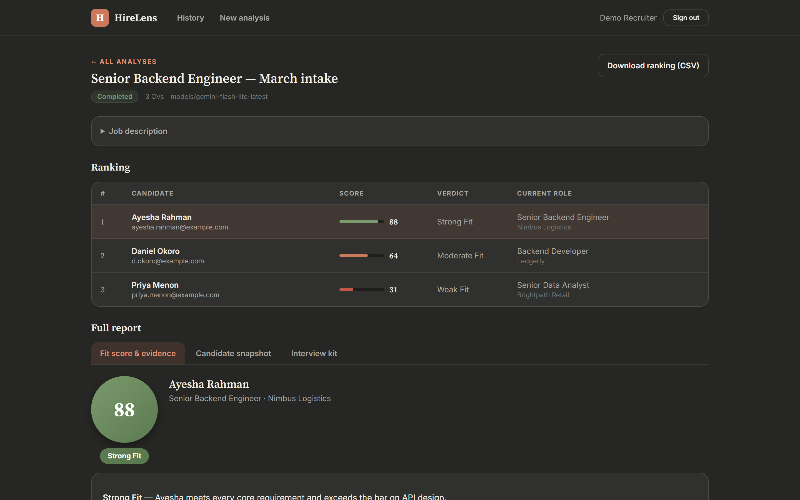
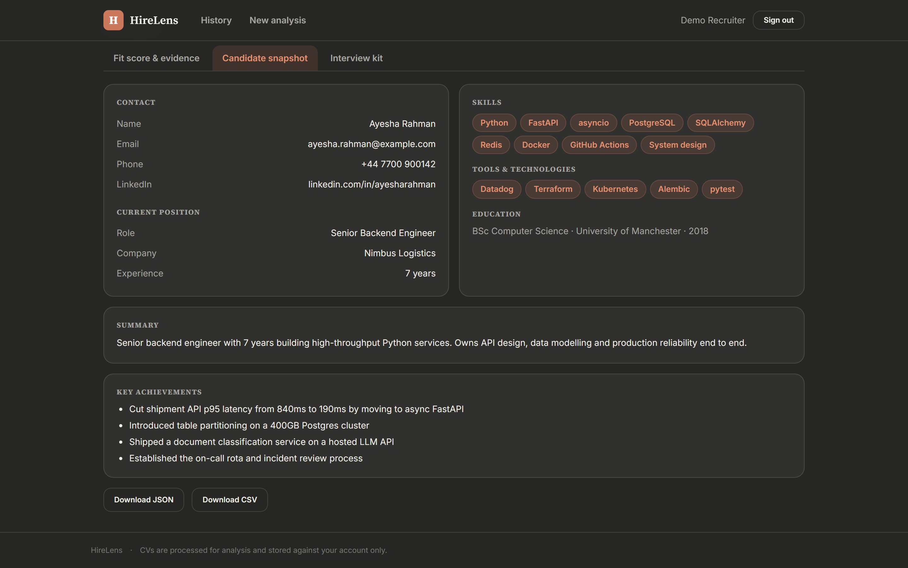
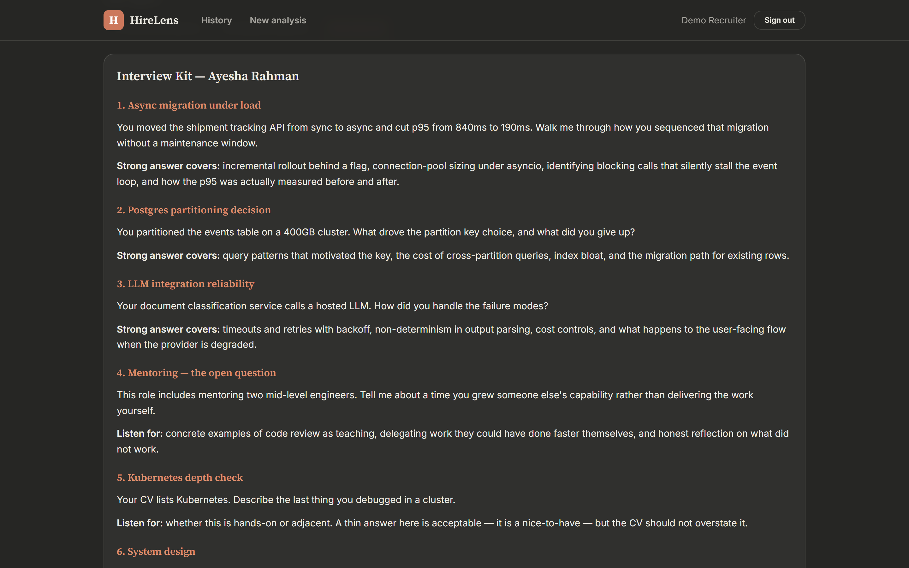
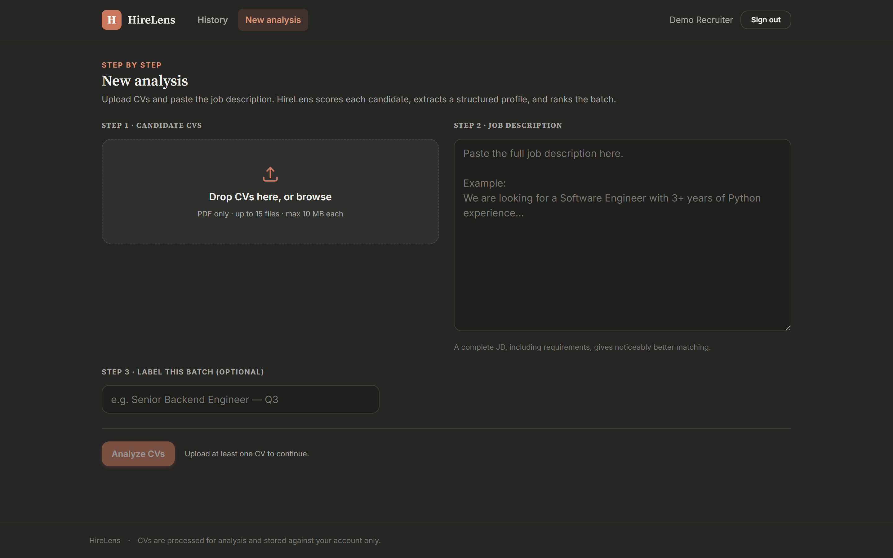
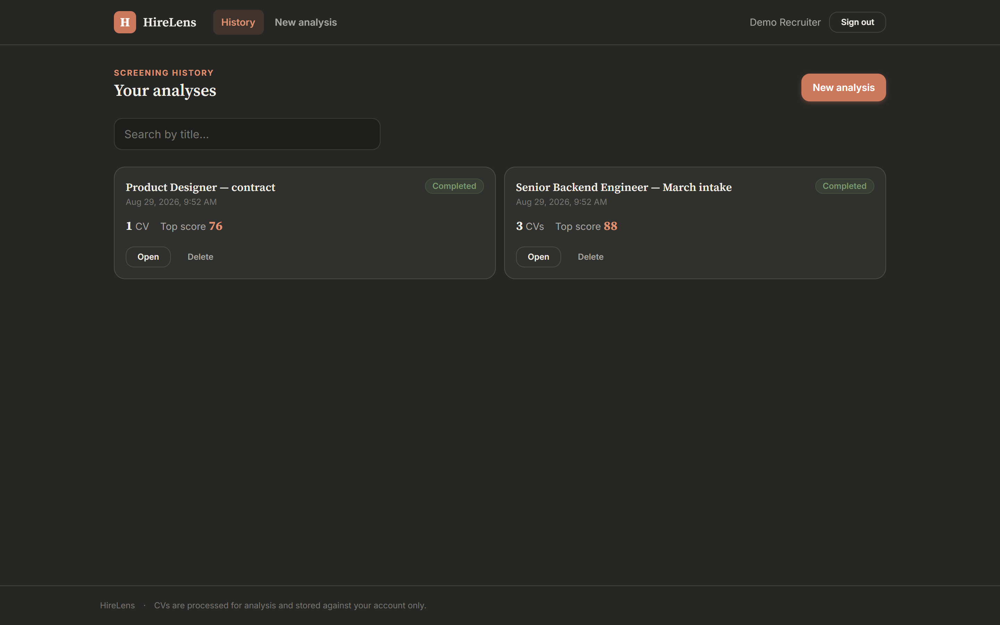
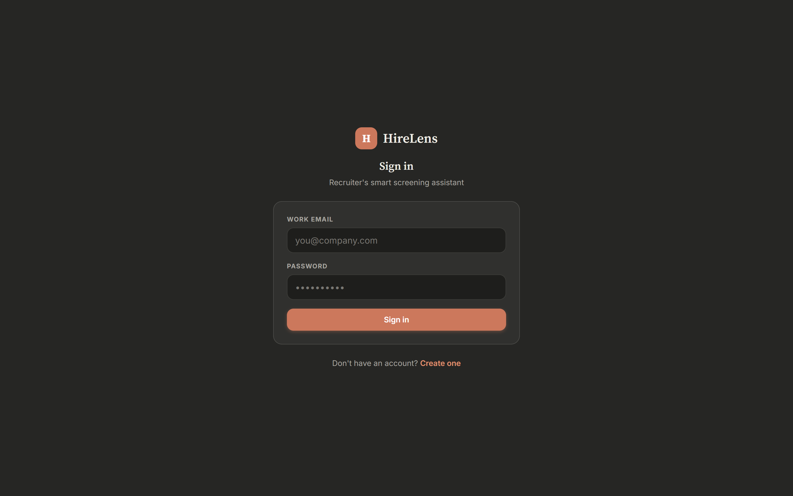
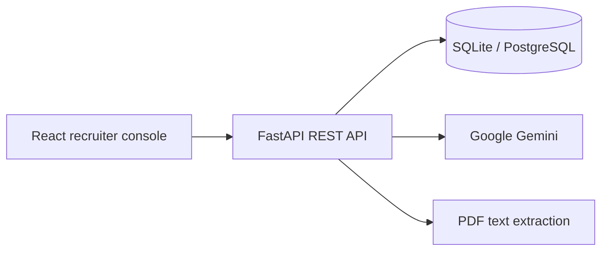

<div align="center">

# HireLens

### Turn CVs into structured hiring insights.

Screen candidate batches against a job description, review evidence-backed fit scores,
and prepare focused interviews in one recruiter workspace.

[](https://github.com/abdulhaseebofficial/hirelens/actions/workflows/ci.yml)


[](LICENSE)

[Quick start](#quick-start) - [Deployment](docs/DEPLOYMENT.md) - [Contributing](CONTRIBUTING.md) - [Report an issue](https://github.com/abdulhaseebofficial/hirelens/issues)

</div>



> Screenshots show fictional demonstration data, not actual model output.

## What you can do

| Capability | What it delivers |
| --- | --- |
| **Batch screening** | Compare up to 15 PDF CVs against one job description by default. |
| **Fit scoring** | Review 0-100 scores, supporting evidence, gaps, and fit verdicts. |
| **Candidate profiles** | Extract experience, skills, education, and contact information. |
| **Interview preparation** | Generate candidate-specific questions and evaluation rubrics. |
| **Saved analyses** | Return to screening history in your account. |
| **CSV export** | Take candidate results into your existing workflow. |

AI-generated scores and summaries support recruiter review; verify them against the original CV.

## Product tour

<details>
<summary><strong>Candidate profile and interview kit</strong></summary>




</details>

<details>
<summary><strong>Upload, dashboard, and sign in</strong></summary>





</details>

## Architecture



| Layer | Technology |
| --- | --- |
| Frontend | React 19, TypeScript, Vite 6, Tailwind CSS 4, React Router 7 |
| API | FastAPI, Pydantic 2, async SQLAlchemy, Alembic |
| AI | Google Gemini through the Google Gen AI SDK |
| Storage | SQLite for local development; PostgreSQL supported |
| Authentication | JWT access tokens, rotating refresh tokens, bcrypt |
| Quality checks | pytest, Ruff, ESLint, TypeScript, production build |

## Quick start

You need **Python 3.11+**, **Node.js 22**, and a Google Gemini API key for analysis.

```bash
git clone https://github.com/abdulhaseebofficial/hirelens.git
cd hirelens
```

### 1. Start the backend

```bash
cd backend
python -m venv .venv
```

Activate the environment:

```bash
# macOS / Linux
source .venv/bin/activate
```

```powershell
# Windows PowerShell
.venv\Scripts\Activate.ps1
```

Install dependencies and create your configuration:

```bash
pip install -r requirements-dev.txt
```

Copy `backend/.env.example` to `backend/.env`. Set `GOOGLE_API_KEY` and a persistent
`SECRET_KEY`. Generate a secret with:

```bash
python -c "import secrets; print(secrets.token_urlsafe(48))"
```

From `backend/`, run:

```bash
alembic upgrade head
uvicorn app.main:app --reload
```

API: **http://127.0.0.1:8000** - Interactive API documentation: **http://127.0.0.1:8000/docs**

### 2. Start the frontend

Open another terminal at the repository root:

```bash
cd frontend
npm ci
npm run dev
```

Open **http://localhost:5173**, register an account, and create an analysis.
Try [sample_cv.pdf](sample_cv.pdf) with the text from [sample_jd.txt](sample_jd.txt).

CVs must be PDFs with selectable text; scanned PDFs need OCR before upload.
Paste the job description as text (at least 50 characters).

### 3. Check the connection

Open **http://127.0.0.1:8000/api/v1/health/ready**. The `checks.database` field should
be `ok`. The overall status also depends on whether Gemini is configured.
`/api/v1/health` checks only that the API process is running.

## Configuration

When launched from `backend/`, settings load `backend/.env`, followed by the root
`.env` (root values take precedence). Process environment variables override both.
**The backend does not automatically load `.env.local`.**

| Variable | Purpose / default |
| --- | --- |
| `GOOGLE_API_KEY` | Required for AI analysis. |
| `SECRET_KEY` | Set a persistent random value for signed tokens. |
| `DATABASE_URL` | Defaults to `sqlite+aiosqlite:///./hirelens.db`. |
| `CORS_ORIGINS` | Allowed frontend origins; localhost is configured for development. |
| `MAX_BATCH_SIZE` | `15` CVs per analysis. |
| `MAX_FILE_SIZE_MB` | `10` MB per file. |
| `VITE_API_BASE_URL` | Frontend API URL; defaults to `/api/v1` through the dev proxy. |

See [backend/.env.example](backend/.env.example) for all backend settings and
[the deployment guide](docs/DEPLOYMENT.md) for production configuration.

## Development

Run the same checks as [CI](.github/workflows/ci.yml):

```bash
# From backend/
ruff check .
pytest -q
```

```bash
# From frontend/
npm run lint
npm run typecheck
npm run build
```

## Repository map

```text
hirelens/
  backend/          FastAPI application, migrations, and tests
  frontend/         React recruiter console
  docs/             Deployment guide and product screenshots
  .github/          CI, issue templates, and pull request template
  legacy/           Original Streamlit prototype
```

## Documentation and community

- [Deployment guide](docs/DEPLOYMENT.md) - hosting, database setup, and readiness checks.
- [Contributing](CONTRIBUTING.md) - local checks and pull request expectations.
- [API routes](backend/app/api/v1/) - implementation; run the API to browse `/docs`.
- [Issues](https://github.com/abdulhaseebofficial/hirelens/issues) - bugs and feature requests.

Older root-level guides describe the Streamlit prototype and are retained as historical reference.
Use this README for the current FastAPI + React application.

## License

Released under the [MIT License](LICENSE).
